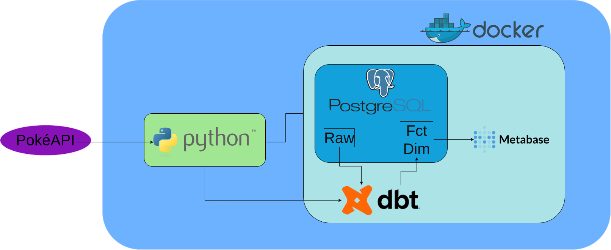
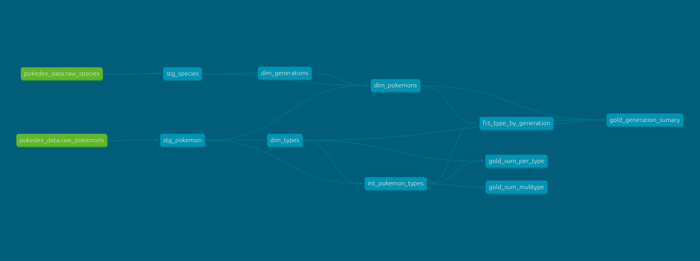
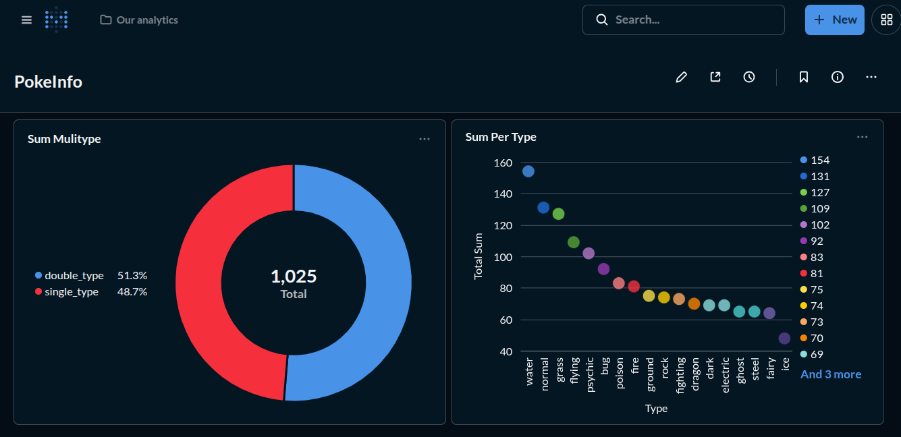

# ⚡ PokeData

> An end-to-end ELT project: Pokémon data is extracted from [PokeAPI](https://pokeapi.co), loaded raw into PostgreSQL, transformed with dbt and explored in Metabase.

[](#)


## 📐 Architecture



**Flow:** PokeAPI → Python (extract + load) → PostgreSQL `raw` tables → dbt (staging → dimensions/facts → gold) → Metabase.

| Tool | Role |
|---|---|
| **Python** (`httpx`, `polars`) | Concurrent extraction from PokeAPI, cleaning, and loading into PostgreSQL |
| **PostgreSQL** | Data warehouse |
| **dbt** | Transformations, tests and documentation |
| **Metabase** | Dashboards and exploration |
| **Docker Compose** | Runs PostgreSQL, dbt and Metabase |

## 🚀 Key Features

- **Async ingestion:** 1,025 Pokémon and 1,025 species records fetched concurrently (capped at 20 simultaneous requests).
- **ELT approach:** data is loaded as-is into `raw_*` tables, and all modeling happens in the warehouse with dbt.
- **Tested models:** 10 dbt models and 9 tests (`not_null`, `unique`, `relationships`).
- **Dashboards:** Pokémon types and rarity by generation, built on the gold tables.

## 🧱 Data Layers


| Layer | Tables | Purpose |
|---|---|---|
| **Raw** | `raw_pokemons`, `raw_species` | Data exactly as loaded from the API |
| **Staging** | `stg_pokemon`, `stg_species` | Cleaned and typed |
| **Intermediate** | `int_pokemon_types` | One row per Pokémon–type pair |
| **Dimensions / Facts** | `dim_pokemons`, `dim_types`, `dim_generations`, `fct_type_by_generation` | Modeled business entities |
| **Gold** | `gold_sum_per_type`, `gold_sum_multitype`, `gold_generation_summary` | Ready for dashboards |

## ✅ Prerequisites

- [Docker](https://docs.docker.com/get-docker/) with Docker Compose
- [uv](https://docs.astral.sh/uv/) (Python package manager)

## 🛠️ How to Run

This project was developed in GitHub Codespaces, where the Docker bridge network between containers did not work. Because of that there are two compose files: one using host networking (Codespaces) and one using a regular network (your machine). Both are used with the same commands; only one line in `.env` changes.

### 1. Configure the environment

```bash
cp .env.example .env
```

Edit `.env` with your own values:

```dotenv
DB_USER=yourusername
DB_PASS=yourpassword
DB_NAME=yourdatabase
DB_PORT=5432
```

**Only if you are on GitHub Codespaces**, also add this line (it is commented out in `.env.example`):

```dotenv
COMPOSE_FILE=docker-compose-codespace.yml
```

> Check which compose file will be used with `docker compose config --files`.

### 2. Start the containers

```bash
docker compose up -d
```

### 3. Run the pipeline

```bash
uv sync
uv run src/main.py
```

This extracts the data from PokeAPI, loads it into the `raw_*` tables and then runs `dbt build` (models and tests).

### 4. Open Metabase

Go to <http://localhost:3000>. On the first access, Metabase asks you to create an admin account and then to add your database:

| Field | Value |
|---|---|
| Type | PostgreSQL |
| Host | `localhost` on Codespaces, `db` on your machine |
| Port | `5432` |
| Database / user / password | Same values as in your `.env` |

Then click **New → Question** and pick the `gold_*` tables, which are ready to be charted.

### Stopping

```bash
docker compose down
```

Data is kept in the `poke_data` Docker volume. Add `-v` to remove it as well.

## 📁 Project Structure

```text
.
├── src/                          # Extraction, loading and orchestration (Python)
├── dbt/                          # dbt project (models, tests)
├── images/                       # Diagram and dashboard screenshots
├── docker-compose.yml            # Regular setup (your machine)
├── docker-compose-codespace.yml  # Host-network setup (GitHub Codespaces)
└── .env.example                  # Environment variables template
```

## 📈 Insights Preview



## 🙏 Credits

Data provided by [PokeAPI](https://pokeapi.co).